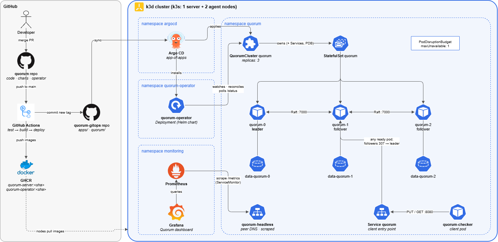
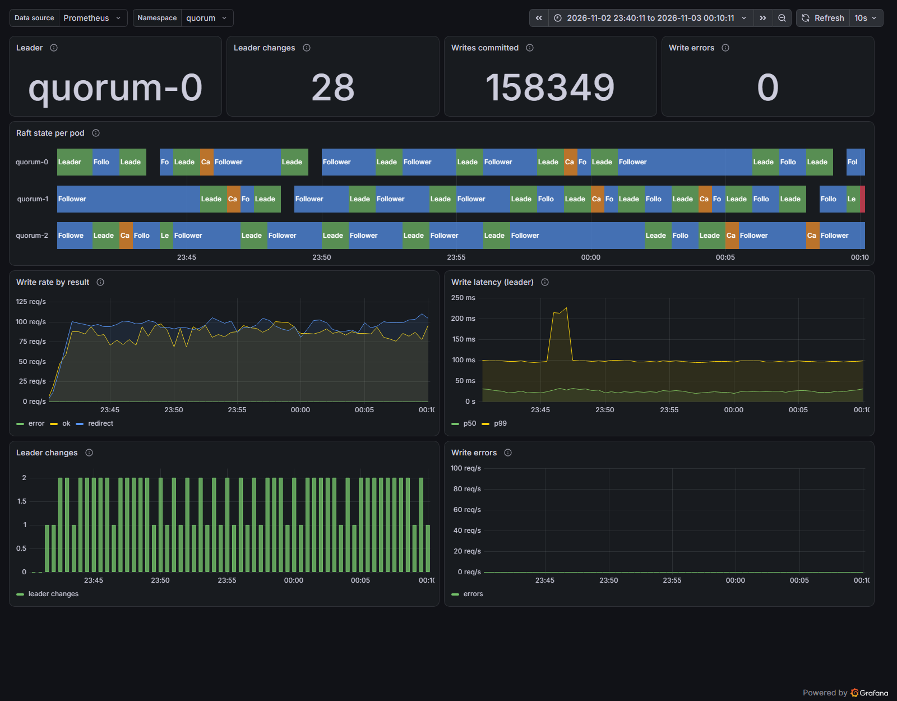
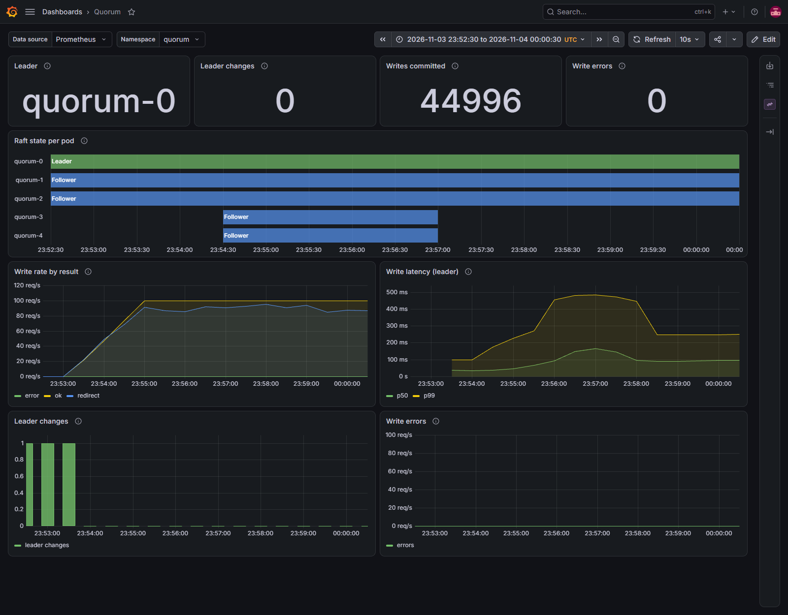
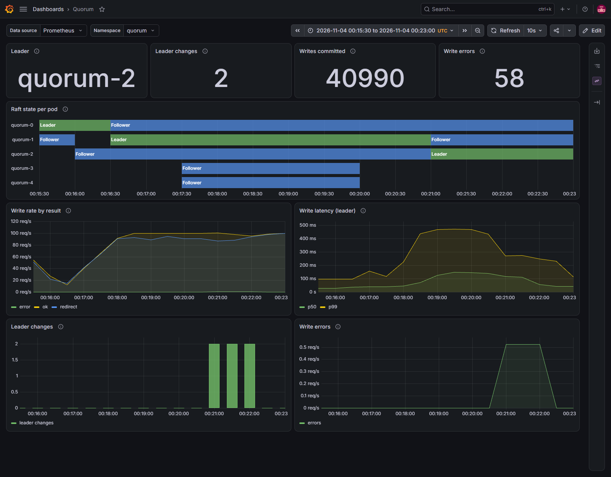

<div align="center">

# Quorum

**A Raft-replicated key-value store with a Kubernetes operator that keeps it available through crashes, scaling and upgrades, and the fault-injection experiments that prove it.**


</div>

## Results at a glance

| | |
|---|---|
| 🛡️ **0 lost acknowledged writes** | across **517,331** acknowledged writes and **86 leader kills** (SIGKILL, 3 runs of 30 min at 100 writes/s) |
| ⚡ **~2 s median failover** | median write outage of 2.05–2.22 s after a leader crash, matching Raft's election timeout |
| 🩺 **Readiness fix, measured** | a `/readyz` probe cut the kills followed by a second outage from 6 and 4 per run to 1 |
| 📈 **Safe vs. unsafe scaling** | after scaling 3 → 5 → 3, one follower crash cost **0–1 failed writes** with the operator's safe scaling, versus **~600 failed writes and a ~6 s outage** with naive scaling |

## Why

"Survives the loss of one node" is easy to claim and hard to check. Quorum
is a small but complete distributed system built to measure that claim: a
write counts only once a majority has stored it, an operator handles the
Kubernetes side, and a checker sends real load while faults are injected so
data loss and downtime are measured, not assumed.

## What

| Component | Role |
|---|---|
| **quorum-server** (`cmd/quorum-server`) | 3-node KV store on [hashicorp/raft](https://github.com/hashicorp/raft). HTTP API `PUT/GET/DELETE /kv/{key}`, linearizable reads, followers redirect to the leader with `307`. |
| **quorum-operator** (`operator/`) | Turns a `QuorumCluster` custom resource into a StatefulSet, two Services and a PodDisruptionBudget, reports Raft health in its status, and changes Raft membership one member at a time when `spec.replicas` changes. |
| **quorum-checker** (`cmd/quorum-checker`) | Writes unique keys at a fixed rate, reads every acknowledged one back, and measures unavailability. |
| **[quorum-gitops](https://github.com/momoElbn/quorum-gitops)** | Everything that runs in the cluster, deployed by Argo CD. |

Design decisions are written up in [docs/decisions.md](docs/decisions.md).

## How



<sub>Editable source: [docs/architecture.drawio](docs/architecture.drawio) (open it in [draw.io](https://app.diagrams.net)).</sub>

- **Consensus:** Raft commits a write only after a majority has it, so a single node failure can't lose acknowledged data.
- **Operator-managed membership:** new pods join as nonvoters, are promoted once caught up, and are removed from Raft *before* their pods are deleted, so the majority always matches the real cluster.
- **Health-aware traffic:** `/readyz` reports Ready only when a pod knows the current leader, so clients never reach a pod that would answer `503 no leader`.
- **GitOps and CI:** GitHub Actions tests, builds and pushes images to GHCR, then deploys through quorum-gitops and Argo CD. Prometheus and Grafana observe the cluster.

## Quick start

You need Docker, [k3d](https://k3d.io) 5.9+, kubectl and git. Images are public on GHCR, so nothing needs to be built.

```bash
git clone https://github.com/momoElbn/quorum-gitops
cd quorum-gitops
scripts/bootstrap.sh                      # k3d cluster, Argo CD, root app
kubectl -n quorum get quorumcluster -w    # wait until PHASE is Running
```

Argo CD deploys kube-prometheus-stack, the operator and a 3-node `QuorumCluster` from Git.

<details>
<summary><b>Write and read a key, open Grafana, or run without Kubernetes</b></summary>

Write and read a key from inside the cluster (followers redirect to in-cluster DNS names):

```bash
kubectl -n quorum run curl --rm -i --restart=Never --image=curlimages/curl:8.11.1 --command -- \
  sh -c 'curl -sL -X PUT --data hello quorum:8080/kv/greeting && curl -sL quorum:8080/kv/greeting'
```

Grafana (dashboard "Quorum"):

```bash
kubectl -n monitoring port-forward svc/kube-prometheus-stack-grafana 3000:80
# http://localhost:3000, user admin, password admin-local-only (local cluster only)
```

Without Kubernetes: `docker compose -f deploy/docker-compose.yml up -d --build`, then `scripts/status.sh`.

</details>

---

## Experiment E1: leader failure

> **Question:** when the leader crashes, how long do writes fail, and are any acknowledged writes lost?

**Answer:** none were lost, and writes resumed after a median of about 2 s.

```bash
RATE=100 DURATION=30m scripts/run-checker.sh          # terminal 1
MODE=kill INTERVAL=60 COUNT=29 scripts/kill-leader.sh  # terminal 2
```

`MODE=kill` sends SIGKILL to the leader's process. Nothing shuts down
cleanly and leadership isn't handed off, so the two survivors have to detect
missing heartbeats and elect a new leader. The script then replaces the dead
pod and waits until all 3 pods are Ready before the next kill, so each round
is a single failure. Only `204` answers count as acknowledged. Every key and
value is unique, and read-backs are linearizable, so a missing or wrong value
means a write was really lost.

### Results

Runs 1 and 2 are the baseline. Run 3 adds the readiness fix (`/readyz`): a pod
gets client traffic only once it knows the leader.

| | Run 1 | Run 2 | Run 3 (readiness fix) |
|---|---|---|---|
| Leader kills during the write phase | 29 | 29 | 28 ¹ |
| Writes sent | 179,999 | 180,000 | 179,997 |
| Acknowledged | 172,650 (95.9 %) | 171,777 (95.4 %) | 172,904 (96.1 %) |
| **Lost acknowledged writes** | **0** | **0** | **0** |
| **Failover time, median** | **2.05 s** | **2.20 s** | **2.22 s** |
| **Failover time, max** | **3.21 s** | **2.91 s** | **3.69 s** |
| Disruption per kill, median / max | 2.29 s / 8.25 s | 2.24 s / 9.00 s | 2.22 s / 5.32 s ² |
| Kills with a second outage after the election | 6 | 4 | 1 |
| Total time unavailable | 73.5 s (4.1 %) | 82.2 s (4.6 %) | 70.9 s (3.9 %) |
| Failed writes that were applied anyway | 61 | 47 | 74 |

<sub>¹ One round found no leader (an election was running) and was skipped, so the 29th kill came after the writes ended.<br>
² 21.11 s if you also count an election that started 18 s after the kill, with no kill causing it (see below).</sub>

- **Nothing was lost:** all 517,331 acknowledged writes were read back correctly.
- **Failover time:** for each kill, the longest write outage that starts within 5 s of it. The median of about 2 s
  matches hashicorp/raft's defaults (a follower waits 1–2 s without a heartbeat before it calls an election). The three
  runs differ by at most 0.17 s on the median. Readiness doesn't change it: it's the election itself.
- **Disruption per kill** also counts errors after the election. In runs 1 and 2, writes failed again for up to 6.5 s
  after 6 and 4 kills: the replacement pod reported Ready before it knew the leader, got client traffic and answered
  `503 no leader`. With `/readyz`, that's gone. The one remaining case in run 3 is two outages 1.7 s apart within the
  same failover, which looks like a split vote.
- **Elections without a kill:** run 3 had 3 short outages (2.0 s, 1.9 s, 3.0 s) that no kill caused, each 18–40 s after a
  kill, around when the replacement pod comes back. The Raft term also rose far faster than the number of kills. The
  likely cause is the returning pod triggering an election before the leader reaches it; the pods' logs were gone by
  the time this was found, so it's not confirmed. The records of runs 1 and 2 are gone too, so it's unknown whether they
  had them.
- **Applied anyway:** the write was committed, but the leader died before it could reply. A failed write means
  "outcome unknown", so the checker reports these separately and doesn't count them as lost.



*Run 2 in Grafana: the leader moves to a new pod every minute and writes
stay at about 100/s. "Write errors" stays at 0 because requests to a crashed
server never reach it, so only the checker sees those failures.*

<details>
<summary><b>Test conditions</b></summary>

| | |
|---|---|
| PC | AMD Ryzen 5 7600X (6 cores, 12 threads), 32 GB RAM |
| OS | Windows, WSL2 (kernel 6.6.87.2), Ubuntu 26.04 LTS |
| Docker | Docker Desktop 29.1.3 on WSL2: 12 CPUs, 15.2 GiB RAM |
| Kubernetes | k3d 5.9.0, k3s v1.35.5 (1 server + 2 agent nodes) |
| Cluster | 3 replicas, one pod per node, 1 GiB local-path volume each |
| Load | 100 writes/s for 30 min, 2 s client timeout |
| Fault | leader SIGKILLed every 60 s, 29 times; next kill only once all 3 pods are Ready |
| Version | runs 1 and 2: commit `be31ee1`; run 3: commit `1e59c36` (readiness fix) |
| Date | 2026-11-03; run 1 04:06–04:38 UTC, run 2 04:40–05:11 UTC, run 3 22:57–23:27 UTC |

</details>

---

## Experiment E3: scaling

> **Question:** does scaling 3 → 5 → 3 under load lose writes, and how much fault tolerance is left afterwards?

**Answer:** neither mode lost data, but only safe scaling kept the cluster's fault tolerance. After naive scaling, a single follower crash took writes down for about 6 s.

| | |
|---|---|
| Safe mode | The operator adds each pod as a nonvoter, promotes it once it has caught up, and removes members from Raft before deleting their pods |
| Unsafe mode | `spec.unsafeScaling: true`: pods join by themselves and the StatefulSet just follows `spec.replicas`; nothing is removed from Raft |
| Metrics | Lost acknowledged writes; failed writes per phase; Raft members after 5 → 3; the cost of one follower crash after 5 → 3 |

```bash
RATE=100 DURATION=10m scripts/run-checker.sh   # terminal 1
scripts/scale-experiment.sh                    # terminal 2; UNSAFE=1 for the baseline
```

`scale-experiment.sh` waits 60 s, scales to 5 and waits until it's done, holds
120 s, scales to 3 and waits, holds 60 s, SIGKILLs one follower, and holds
120 s. It prints a UTC timestamp for every event, which is how failed writes
are split by phase. Each mode ran twice, each run on a fresh 3-node cluster.
Unsafe runs need that anyway, because they leave ghost members behind.

### Results

| | Safe 1 | Safe 2 | Unsafe 1 | Unsafe 2 |
|---|---|---|---|---|
| Writes sent / acknowledged | 59,999 / 59,997 | 59,999 / 59,999 | 60,000 / 59,408 | 60,000 / 59,393 |
| **Lost acknowledged writes** | **0** | **0** | **0** | **0** |
| Failed writes during 3 → 5 | 0 | 0 | 0 | 0 |
| Failed writes during 5 → 3 | 1 | 0 | 1 | 1 |
| **Raft members after 5 → 3** | **3** | **3** | **5** (2 without a pod) | **5** (2 without a pod) |
| **Follower crash after 5 → 3: failed writes / longest outage** | **1 / 0.01 s** | **0 / 0 s** | **591 / 5.87 s** | **606 / 6.02 s** |
| Time for 3 → 5 / 5 → 3 | 22 s / 3 s | 19 s / 1 s | 14 s / 2 s | 16 s / 2 s |

- **Nothing was lost in either mode.** Raft never acknowledges a write that a majority hasn't stored, so naive scaling
  doesn't lose data. It costs availability.
- **Unsafe scale-down leaves ghost voters.** The StatefulSet deleted quorum-3 and quorum-4, but Raft still counted 5
  voters, so 3 of 5 must answer. The follower crash left 2 of 5: no majority. The leader stepped down and writes failed
  with `503 no leader elected yet` until the crashed pod was back, about 6 s later. That's short only because a killed
  pod restarts quickly. If the node had died, writes would stay down until it came back.
- **Safe scale-down shrinks the majority with the membership** (5 → 4 → 3 voters), so the same crash leaves 2 of 3, which
  is still a majority. Safe 2 had no failed writes at all. The single failures in safe 1 and at 5 → 3 were the client
  Service sending a request to a pod at the moment it went away (connection refused or reset), not Raft.
- **Safe scaling is a little slower** going up (19–22 s vs 14–16 s), because each new member catches up and is promoted
  before the next pod starts. Going down, both take 1–3 s.
- **"Applied anyway":** 56 and 54 of the unsafe runs' failed writes were committed after all: the leader lost its
  majority mid-commit (`leadership lost while committing log`), and Raft committed the entries once the majority was
  back.

So: safe scaling took the cluster 3 → 5 → 3 under 100 writes/s with 0 lost writes and then absorbed a follower crash with
0–1 failed writes. After naive scaling, the same crash caused a 5.9–6.0 s total write outage (about 600 failed writes).



*Safe run 1: quorum-3 and quorum-4 join as followers and leave again, and quorum-0 stays the leader throughout. p99
write latency rises from about 100 ms to about 500 ms while there are 5 voters: a write needs 3 acknowledgements
instead of 2.*



*Unsafe run 1: after the follower crash at 00:20:24, the leader moves from quorum-1 to quorum-2, and the server reports
write errors (`leadership lost while committing log`). The dashboard can't show the ghost voters: quorum-3 and
quorum-4 disappear from the chart but are still in Raft's configuration.*

<details>
<summary><b>Test conditions</b></summary>

Same PC, WSL2, Docker (12 CPUs, 15.2 GiB) and k3d/k3s as E1.

| | |
|---|---|
| Load | 100 writes/s for 10 min, 2 s client timeout, started before the timeline (after the switch to unsafe mode, so that rolling restart isn't counted) |
| Version | quorum-server and quorum-operator at commit `4b57d9f` |
| Date | 2026-11-03/04; safe 23:53 and 00:04 UTC, unsafe 00:16 and 00:28 UTC |
| Cluster | recreated from scratch (QuorumCluster and volumes deleted) before the first run and before each unsafe run |

</details>

---

## Known limitation

The store keeps every key in memory, and a snapshot encodes the whole map at once. After the three E1 runs, the
~540,000 keys no longer fit in the pods' 256 MiB memory limit, so the pods were OOMKilled at every snapshot or restart
and the cluster had to be recreated before E3. Streaming snapshots or an on-disk store would remove this limit.

## Repository layout

| Path | What |
|---|---|
| `cmd/quorum-server`, `internal/store` | Raft key-value server |
| `cmd/quorum-checker` | load and data-loss checker |
| `operator/` | kubebuilder operator (`QuorumCluster` CRD) |
| `charts/` | Helm charts for the server and the operator |
| `deploy/` | Docker Compose setup and an example `QuorumCluster` |
| `scripts/` | `run-checker.sh`, `kill-leader.sh`, `scale-experiment.sh`, `status.sh`, `write-loop.sh` |
| `.github/workflows/ci.yml` | test, build, push to GHCR, deploy via quorum-gitops |

